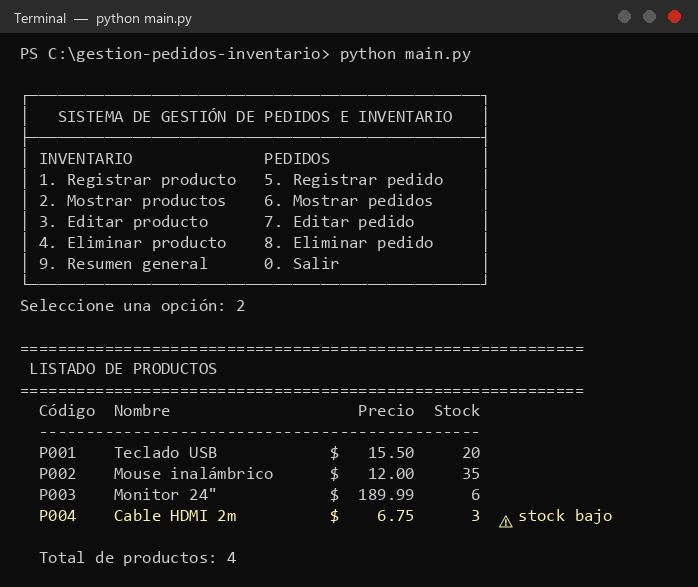
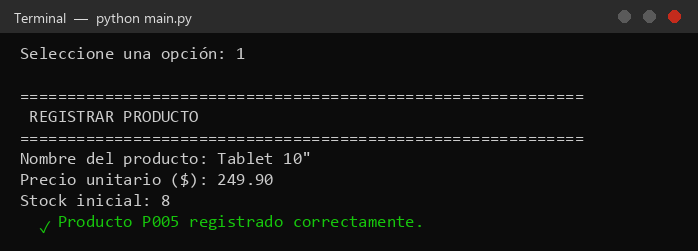
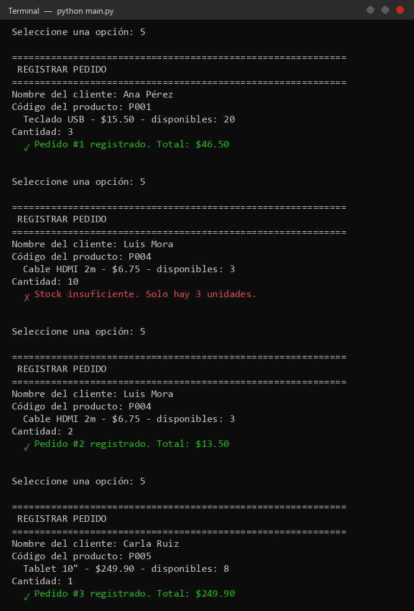
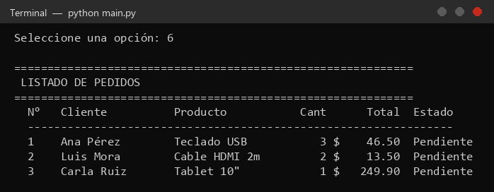
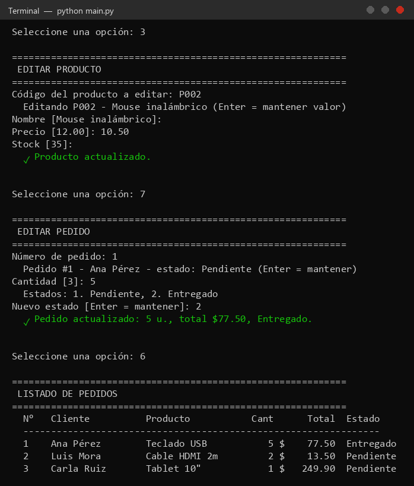
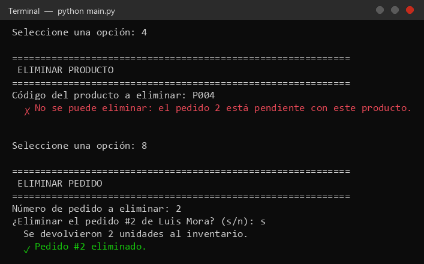
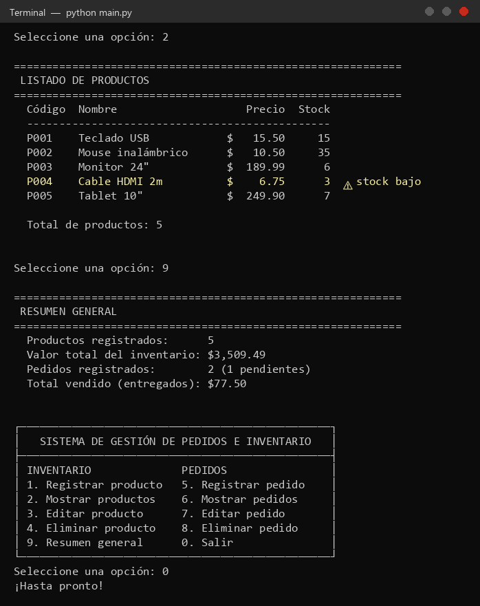

# Sistema básico de gestión de pedidos e inventario

**C8T1 - Uso de Arreglos Unidimensionales en la solución de problemas reales (Reto 2)**
**Módulo:** M1 TICs para Tecnólogos 2026
**Tema:** 5. Arreglos y tipos abstractos de datos (Parte 1)
**Autor:** Michael Sebastián Ordóñez Tulcán
**Lenguaje:** Python 3 (sin librerías externas)

Programa de consola que permite **registrar, mostrar, editar y eliminar** productos del inventario y pedidos de clientes. Los datos se almacenan en **arreglos unidimensionales** (listas de Python) y el código está organizado en módulos con funciones para cada acción.

## Ejecución

```bash
python main.py
```

El sistema arranca con 4 productos de ejemplo para poder probarlo de inmediato.

## Estructura del proyecto

```
├── main.py          # Menú principal y resumen general
├── inventario.py    # Registrar, mostrar, editar y eliminar productos
├── pedidos.py       # Registrar, mostrar, editar y eliminar pedidos
├── utilidades.py    # Lectura y validación de datos de entrada
└── capturas/        # Imágenes del programa en ejecución
```

## Uso de arreglos unidimensionales

El sistema usa dos arreglos (listas):

```python
productos = [ {"codigo": "P001", "nombre": "Teclado USB", "precio": 15.50, "stock": 20}, ... ]
pedidos   = [ {"numero": 1, "cliente": "Ana", "codigo_producto": "P001", "cantidad": 3, ...}, ... ]
```

Cada posición del arreglo guarda un registro. Las operaciones básicas sobre arreglos que se aplican son:

| Operación | Dónde se usa | Ejemplo en el código |
|---|---|---|
| **Escritura** (agregar) | Registrar producto o pedido | `productos.append(producto)` |
| **Lectura** por índice | Editar y buscar | `p = productos[i]` |
| **Iteración** | Listados, búsquedas, totales | `for p in productos:` |
| **Búsqueda secuencial** | Buscar por código o número | `buscar_producto()` retorna el índice o `-1` |
| **Eliminación** por índice | Eliminar producto o pedido | `productos.pop(i)` |
| **Longitud** | Contadores y validaciones | `len(productos)` |

## Funcionalidades

**Inventario**
- Registrar producto: el código se genera automáticamente (P001, P002, ...).
- Mostrar productos: tabla con alerta de stock bajo (menos de 5 unidades).
- Editar producto: presionando Enter se mantiene el valor actual.
- Eliminar producto: pide confirmación y no permite borrar un producto con pedidos pendientes.

**Pedidos**
- Registrar pedido: valida que el producto exista y que haya stock; descuenta el stock automáticamente.
- Mostrar pedidos: tabla con cliente, producto, cantidad, total y estado.
- Editar pedido: cambia la cantidad (ajusta el stock con la diferencia) y el estado (Pendiente / Entregado).
- Eliminar pedido: si estaba pendiente, devuelve las unidades al inventario.

**Resumen general:** número de productos, valor total del inventario, pedidos pendientes y total vendido.

## Principios de programación aplicados

- **Entrada y salida de datos:** `input()` con validación en `utilidades.py` (no se cae si se escriben letras donde va un número) y salida en tablas con `print` y f-strings.
- **Estructuras condicionales:** validación de stock, existencia de códigos, estados del pedido, confirmaciones.
- **Ciclos:** `while True` para el menú y para repetir la lectura hasta que el dato sea válido; `for` para recorrer los arreglos.
- **Funciones y procedimientos:** cada acción del menú es una función independiente.
- **Escalabilidad:** el menú es una lista de opciones `(clave, texto, función)`. Para agregar una funcionalidad nueva solo se escribe la función y se agrega una línea en `MENU`, sin modificar el resto del programa.

## Capturas del programa en ejecución

### 1. Menú principal y listado de productos


### 2. Registrar un producto


### 3. Registrar pedidos (incluye validación de stock insuficiente)


### 4. Listado de pedidos


### 5. Editar producto y pedido


### 6. Eliminar producto (protegido) y eliminar pedido (devuelve stock)


### 7. Inventario actualizado, resumen general y salida

